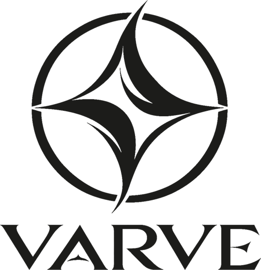
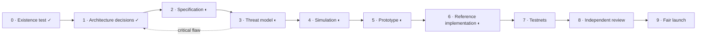

<picture>
  <source media="(prefers-color-scheme: dark)" srcset="assets/brand/varve-logo-light.png">
  
</picture>

<h3>Proof-of-work money built to outlast its cryptography</h3>

  <a href="https://isamunagai.github.io/varve/">Website</a> ·
  <a href="whitepaper/varve-whitepaper.md">Whitepaper</a> ·
  <a href="https://isamunagai.github.io/varve/journal.html">Journal</a> ·
  <a href="adr/">Design decisions</a> ·
  <a href="protocol/">Specification</a> ·
  <a href="https://github.com/IsamuNagai/varve/discussions">Discussions</a> ·
  <a href="https://x.com/isanagai">X</a>

  
  
  
  

---

> [!WARNING]
> **Mainnet has not launched and no coin can be bought.** There will never be a
> presale, ICO, premine, founder allocation, or airdrop, and Varve has no
> "contract address" on any other chain. Anyone selling "Varve" or "VARV" is
> running a scam. No one from this project will ever ask for your seed phrase.

## Overview

Bitcoin proved that money can be scarce without anyone in charge. Varve asks
what that money should look like if it were designed today for the next
hundred years, and answers with a fair-launched proof-of-work network built
around four ideas:

- **Quantum-resistant from genesis.** Every coin is protected by the NIST
  standards ML-DSA (FIPS 204) and SLH-DSA (FIPS 205), a hash-based scheme as
  an independent second family. There are no elliptic-curve coins to migrate,
  ever.
- **Cryptography that can evolve.** Every output records its signature scheme.
  New schemes are added and weak ones retired by planned upgrades, without a
  new coin or a restart.
- **Custody that outlives keys.** Native timelocked recovery paths for
  inheritance, disaster recovery and cold storage, with no smart-contract VM.
  After its delay, a recovery key is a second owner, not a revocation switch
  ([details](protocol/transactions.md#81-recovery-trust-model-informative)).
- **Verifiable on a laptop.** Block capacity is set by what an ordinary computer
  can check: the signatures in a worst-case full block verify in under 50 ms on
  one core.

**Where it stands.** The specification covers every consensus rule. A
prototype, a verifier written only from the specification, and the reference
node agree on every consensus test vector, including real post-quantum
signatures and RandomX hashes. The [reference node](node/) mines, syncs,
sends payments and survives reorganizations in multi-node tests on every
change. Real nodes are [battle-tested](battle/) against invalid blocks, double
spends, chain rewrites, corrupted data and power cuts: the first run found two
bugs, both fixed, and the second passed all 55 tests. The
[Strata](node/crates/strata/) desktop wallet and the
[Varvescan](https://isamunagai.github.io/varve/scan/) explorer are ready for
testnet. The testnet genesis is fixed, and the public testnet opens with its
first seed node. Mainnet follows only when the
[readiness checklist](https://isamunagai.github.io/varve/mainnet.html) is
complete, including a public, named security audit.

## Design at a glance

| Area | Direction | Decision record |
| --- | --- | --- |
| Ledger | UTXO with typed outputs; closed policy set (single key, or key plus timelocked recovery) | [ADR-0001](adr/0001-ledger-and-typed-outputs.md) |
| Signatures | ML-DSA-65 primary, SLH-DSA-SHA2-128s recovery, SHA3-256 key commitments | [ADR-0002](adr/0002-signature-schemes-and-commitments.md) |
| Proof of work | RandomX v2 with a Varve-specific salt; SHA-256d fallback | [ADR-0003](adr/0003-proof-of-work.md) |
| Issuance | Smooth decay, 8-year half-life, then a small fixed tail | [ADR-0004](adr/0004-monetary-policy.md) |
| Difficulty | ASERT per-block adjustment; time-warp resistant | [ADR-0005](adr/0005-difficulty-adjustment.md) |
| Capacity and fees | ~5-minute blocks; weight = bytes + verification + UTXO growth; market fees | [ADR-0006](adr/0006-block-interval-weight-and-fees.md) |
| Addresses | Bech32m with prefixes `varve` / `tvarve` | [ADR-0007](adr/0007-address-format.md) |
| Launch | Genesis derived from six future Bitcoin block headers; no premine | [ADR-0008](adr/0008-fair-launch-and-genesis.md) |
| Reference node | Rust, no third-party crates; pinned liboqs and RandomX | [ADR-0011](adr/0011-reference-node-architecture.md) |
| Crypto emergencies | v1: lifecycle states and recovery paths. Commit–delay–reveal deferred to research | [ADR-0009](adr/0009-emergency-migration-commit-delay-reveal.md) |

**Units:** 1 varve = 100,000,000 laminae · **Ticker:** VARV

## Roadmap

<!-- status:begin -->

✓ done · ◐ in progress. Generated from `registers/status.json`.
<!-- status:end -->

Every phase ends at a gate. Mainnet launches when the gates are met, not
before, and its genesis comes from six future Bitcoin blocks, so everyone
starts at the same moment.

## Repository

| Path | Contents |
| --- | --- |
| [`whitepaper/`](whitepaper/) | Draft whitepaper |
| [`adr/`](adr/) | Architecture Decision Records: one protocol decision per file |
| [`protocol/`](protocol/) | Normative specification drafts: consensus, upgrades, P2P, wallet |
| [`test-vectors/`](test-vectors/) | Consensus, chain, signature, genesis and proof-of-work vectors |
| [`node/`](node/) | Reference node, miner, public API ([`API.md`](node/API.md)) and the Strata wallet, in Rust (testnet software) |
| [`battle/`](battle/) | Battle-test harness, raw results and charts |
| [`docs/scan/`](docs/scan/) | Varvescan block explorer (static, served with the website) |
| [`prototype/`](prototype/) | Disposable Python prototype of the consensus rules |
| [`verifier/`](verifier/) | Independent implementation written only from the specification |
| [`audits/`](audits/) | Review findings and how each was resolved |
| [`registers/`](registers/) | Decision register, threat model, research sources, open questions, project status |
| [`simulations/`](simulations/) | Reproducible models (issuance, difficulty, capacity) |
| [`tools/`](tools/) | Vector generators, pinned RandomX and liboqs builds, hygiene scanners |
| [`docs/`](docs/) | Project website, served by GitHub Pages (generated from [`site/`](site/) by `tools/build-site.py`) |
| [`assets/brand/`](assets/brand/) | Logo files |

## Contributing

Review is the most valuable contribution right now. Read the specification and
the ADRs, try to break them, and open an issue with evidence. Once the testnet
opens, run a node and mine. See [CONTRIBUTING.md](CONTRIBUTING.md).
Engineering discussion takes place in
[Discussions](https://github.com/IsamuNagai/varve/discussions). Price talk does not belong here.

## Security

Report vulnerabilities privately through
[GitHub private vulnerability reporting](https://github.com/IsamuNagai/varve/security/advisories/new).
See [SECURITY.md](SECURITY.md). AI-assisted analysis is not a security audit;
mainnet requires independent human review.

## License

Dual-licensed under [MIT](LICENSE-MIT) or [Apache-2.0](LICENSE-APACHE), at your option.

Started by Isamu Nagai · progress in the <a href="https://isamunagai.github.io/varve/journal.html">journal</a> and on <a href="https://x.com/isanagai">X</a>. Nothing in Varve depends on any one person.
