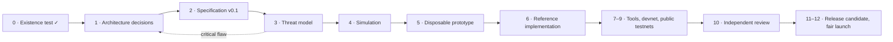

<picture>
  <source media="(prefers-color-scheme: dark)" srcset="assets/brand/varve-logo-light.png">
  
</picture>

<h3>Long-horizon proof-of-work money with post-quantum ownership</h3>

  <a href="https://isamunagai.github.io/varve/">Website</a> ·
  <a href="whitepaper/varve-whitepaper.md">Whitepaper</a> ·
  <a href="adr/">Design decisions</a> ·
  <a href="protocol/">Specification</a> ·
  <a href="https://github.com/IsamuNagai/varve/discussions">Discussions</a>

  
  
  

---

> [!WARNING]
> **No network and no coin exist.** There will never be a presale, ICO, premine,
> founder allocation, or airdrop. Anyone selling "Varve" or "VARV" today is
> running a scam. No one from this project will ever ask for your seed phrase.

## Overview

Varve is an open-source research project asking one question: *if neutral
digital money were designed today for a 50 to 100 year horizon, what should it
look like?*

The working answer is a scarce, permissionless, fair-launched proof-of-work
network built around four ideas:

- **Post-quantum ownership from genesis.** It uses standardized signatures:
  ML-DSA (FIPS 204), plus SLH-DSA (FIPS 205) as an independent recovery family.
  It has no legacy elliptic-curve outputs to migrate.
- **Cryptographic agility.** Every output records its signature scheme. Schemes
  are added, deprecated and retired through a defined lifecycle, without
  restarting the chain.
- **Custody that outlives keys.** Native timelocked recovery paths support
  inheritance, disaster recovery and long-term cold storage, with no
  smart-contract VM.
- **Verification by ordinary people.** Block capacity is limited by what an
  ordinary computer can verify, not by demand.

The specification is the authority. Reference code begins only once the
specification is precise enough for two independent teams to implement it
compatibly.

## Design at a glance

| Area | Direction | Decision record |
| --- | --- | --- |
| Ledger | UTXO with typed outputs; closed policy set (single key, or key plus timelocked recovery) | [ADR-0001](adr/0001-ledger-and-typed-outputs.md) |
| Signatures | ML-DSA-65 primary, SLH-DSA-SHA2-128s recovery, SHA3-256 key commitments | [ADR-0002](adr/0002-signature-schemes-and-commitments.md) |
| Proof of work | RandomX v2 with distinct safe parameters (working choice); SHA-256d fallback | [ADR-0003](adr/0003-proof-of-work.md) |
| Issuance | Smooth decay, 8-year half-life, then a small fixed tail | [ADR-0004](adr/0004-monetary-policy.md) |
| Difficulty | ASERT per-block adjustment; time-warp resistant | [ADR-0005](adr/0005-difficulty-adjustment.md) |
| Capacity and fees | ~5-minute blocks; weight = bytes + verification + UTXO growth; market fees | [ADR-0006](adr/0006-block-interval-weight-and-fees.md) |
| Addresses | Bech32m with prefixes `varve` / `tvarve` | [ADR-0007](adr/0007-address-format.md) |
| Launch | Genesis derived from a future Bitcoin block header; no premine | [ADR-0008](adr/0008-fair-launch-and-genesis.md) |
| Crypto emergencies | Commit–delay–reveal migration | [ADR-0009](adr/0009-emergency-migration-commit-delay-reveal.md) |

**Units:** 1 varve = 100,000,000 laminae · **Ticker:** VARV

## Roadmap

Every phase ends at a gate. The project stops rather than launches if the
design cannot pass independent review, keep verification affordable, or remain
independent of its author.

## Repository

| Path | Contents |
| --- | --- |
| [`whitepaper/`](whitepaper/) | Draft whitepaper |
| [`adr/`](adr/) | Architecture Decision Records: one protocol decision per file |
| [`protocol/`](protocol/) | Normative specification drafts (consensus rules) |
| [`registers/`](registers/) | Decision register, threat model, research sources, open questions |
| [`simulations/`](simulations/) | Reproducible models (issuance, difficulty, capacity) |
| [`tools/`](tools/) | Repository hygiene: secret and image-metadata scanners |
| [`docs/`](docs/) | Project website, served by GitHub Pages |
| [`assets/brand/`](assets/brand/) | Logo files |

## Contributing

Review is the most valuable contribution right now. Read the ADRs, try to break
them, and open an issue with evidence. See [CONTRIBUTING.md](CONTRIBUTING.md).
Engineering discussion takes place in
[Discussions](https://github.com/IsamuNagai/varve/discussions). Price talk does not belong here.

## Security

Report vulnerabilities privately through
[GitHub private vulnerability reporting](https://github.com/IsamuNagai/varve/security/advisories/new).
See [SECURITY.md](SECURITY.md). AI-assisted analysis is not a security audit;
mainnet requires independent human review.

## License

Dual-licensed under [MIT](LICENSE-MIT) or [Apache-2.0](LICENSE-APACHE), at your option.

The whitepaper is written under the pen name Isamu Nagai, which does not
refer to any real person. The protocol is meant to matter more than its author.
